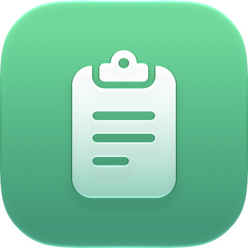

<p align="center">
  
</p>

<h1 align="center">Recopy</h1>

<p align="center">
  <b>Everything you copy, one click away.</b><br>
  A simple clipboard history for the Mac menu bar. Copy text, images or files, and copy any of them
  again later. Copy the same thing twice and it moves back to the top instead of showing up twice.<br>
  Free and open source, made for macOS 26 Tahoe.
</p>

<p align="center">
  <a href="https://github.com/myles-dean/Recopy/releases/latest/download/Recopy.dmg"><b>⬇︎ Download Recopy (DMG)</b></a>
  &nbsp;·&nbsp; <a href="#features">Features</a>
  &nbsp;·&nbsp; <a href="#what-makes-it-different">What makes it different</a>
  &nbsp;·&nbsp; <a href="#install">Install</a>
  &nbsp;·&nbsp; <a href="#faq">FAQ</a>
</p>

<p align="center">
  
  
  
  <a href="https://github.com/myles-dean/Recopy/releases/latest"></a>
</p>

---

**Recopy** keeps everything you copy. Press **⌃⌘V** anywhere (or click the clipboard in the menu
bar), start typing to find what you copied, and press Return. The panel shrinks into a small
**Copied** pill and gets out of the way, and ⌘V pastes it wherever you were.

- **Everything you copy.** Text with its formatting, images, and whatever else apps put on the
  clipboard. For files, Recopy keeps where they are, never the files themselves.
- **No duplicates.** Copying something you've copied before moves it back to the top.
- **Pins and snippets.** Keep what you use all the time at the top, and save text you type often
  (an address, a sign-off, a bit of code) as a snippet.
- **A paste stack.** Copy several things, then paste them back one after another, in order.
- **Edit and preview.** Change a copy's text before copying it again, or Quick Look it first.
- **Leaves your passwords alone.** Anything a password manager marks as secret is never kept.

Your history stays on your Mac. Recopy never connects to the internet.

## What makes it different

- **Copy, not paste.** Picking something puts it back on your clipboard and nothing more. Recopy
  doesn't type into your apps, so it needs no Accessibility permission, and because its panel never
  takes focus from the app you're in, ⌘V works the moment it closes.
- **Files are kept as paths.** Copy a file in Finder and Recopy keeps its location, not a copy of the
  file. Copy it again later and Finder pastes the file, while a text field or Terminal gets its path.
  If the file has moved, it shows dimmed.
- **A paste stack that knows when you've pasted.** Recopy hands the next item to macOS only when an
  app actually asks for it, so each ⌘V moves the stack along without Recopy watching your keyboard.
- **Feels like part of macOS.** A Liquid Glass panel that opens from the menu bar like Control
  Center's menus, a solid clipboard icon that's easy to spot, and motion tuned by hand.
- **Small, free and open.** One menu bar app, MIT licensed, with nothing to sign up for.

### How it compares

| | Recopy | Maccy | Paste | Raycast | Spotlight (macOS 26) |
| --- | :---: | :---: | :---: | :---: | :---: |
| Price | **Free** | Free | $29.99 a year | Free ¹ | Built in |
| Open source | ✓ MIT | ✓ MIT | — | — | — |
| Pins | ✓ | ✓ | ✓ ² | ✓ | — |
| Snippets | ✓ | — | ✓ ² | ✓ | — |
| Paste stack | ✓ | — | ✓ | ≈ ³ | — |
| How much it keeps | 100 to 5,000 copies | You choose | Up to unlimited | 1 day to 3 months ¹ | Up to 7 days ⁴ |

— means the app doesn't offer it, as far as its own site and docs say (checked November 2026).
¹ Longer history needs Raycast Pro.
² Paste organizes both into pinboards.
³ Raycast's Paste Sequentially pastes back through your history, newest first, rather than a stack you build.
⁴ 30 minutes, 8 hours or 7 days, set in System Settings › Spotlight.

If you want your history on your iPhone too, Paste is the one to get. If you'd rather have a launcher
that does a bit of everything, try Raycast. Recopy is for a clipboard history that does one job well
and stays out of the way.

## Features

### The panel

Press **⌃⌘V** from anywhere, or click the clipboard in the menu bar. The search field is ready
straight away: type a few words and the list narrows to copies that contain all of them. It shows
ten rows and scrolls for the rest.

Each row shows where the copy came from: the app's icon for text, a thumbnail for images, the file's
own icon for files. Hover over a row to see which app it was copied from, when, and how many times.
The first nine rows have ⌘1 to ⌘9 beside them.

Click a row (or press Return) to copy it again. It moves to the top, and the panel collapses into a
**Copied** pill under the menu bar icon, then disappears.

### Copying things again

- **Text** comes back with its formatting, so a styled heading from a web page is still a styled
  heading.
- **Images** keep their size and show a thumbnail in the list.
- **Files** go back as files for Finder and other apps that take files, with their paths as text for
  everywhere else. Right-click a file for **Copy Path** or **Show in Finder**.
- **Anything else** an app put on the clipboard (a layer from a design app, cells from a spreadsheet)
  goes back exactly as it was copied.

Copy the same text again, even with different formatting, and it's the same row, moved to the top.

### Pins

Right-click a row and choose **Pin** (or press ⌘P). Pinned copies sit at the top of the list in the
order you pinned them. They don't count toward the history limit, and Clear History leaves them alone.

### Snippets

Switch to **Snippets** at the top of the panel (or press Tab) for text you've saved to copy whenever
you need it. Click **New Snippet**, or right-click any copy and choose **Save as Snippet**. Give a
snippet a name if you like; without one, it shows its first line. Copying a snippet doesn't add it to
your history.

### Paste stack

For filling in forms, or moving several things from one place to another:

1. Click **Paste Stack** in the panel (or right-click the menu bar icon and choose **Start Paste
   Stack**).
2. Copy things in the order you want to paste them. They line up in the panel, numbered.
3. Paste. Each ⌘V pastes the next one.

When the last one has been pasted, the stack turns itself off. While it's on, the menu bar icon
shows how many are left, and you can take items out of the stack or stop it at any time. Stopping it
leaves the next item on your clipboard. You can also add older copies: right-click one and choose
**Add to Paste Stack**, or just click it while the stack is on.

Items in the stack aren't sent to your other devices with Universal Clipboard and are kept out of other
clipboard histories, which would otherwise look like a paste.

### Edit and Quick Look

- **Edit** (⌘E, or right-click › Edit…) opens the text in a small window. Change it and click **Copy**
  (⌘Return). The copy in your history changes too.
- **Quick Look** (Space, or ⌘Y) shows the whole text, image or file. It follows you as you move up and
  down the list.

### Pause and ignore

- **Pause Recording** stops Recopy keeping anything until you turn it back on. The menu bar icon dims
  while it's paused.
- **Ignore Next Copy** skips just the next thing you copy, for a one-off you'd rather not keep.

Both are in Options, and in the menu you get by right-clicking the menu bar icon.

### Privacy

- Password managers and browsers mark the passwords they copy as secret (or as only there for a
  moment). Recopy never keeps those.
- **Ignored Apps** lists apps whose copies Recopy never keeps. Apple's Passwords, Keychain Access,
  1Password and Bitwarden are on it to start with, in case something they copy isn't marked.
- Your history is kept in `~/Library/Application Support/Recopy` and never leaves your Mac.

### Options

Click **Options** at the bottom of the panel (or press ⌘,).

| Option | What it does |
| --- | --- |
| Pause Recording | Stops keeping what you copy until you turn it off |
| Ignore Next Copy | Skips the next copy, then turns itself off |
| Open at Login | Starts Recopy when you log in (on from the first launch) |
| Open Recopy | The shortcut that opens the panel. Click it and type a new one; Delete clears it |
| Keep | How many copies to keep: 100, 500, 1,000 or 5,000. Pinned copies don't count |
| Ignored Apps | Apps whose copies aren't kept. Click one to remove it, or **Choose App…** to add one |
| Clear History | Removes every copy except the pinned ones (click twice to confirm) |
| Quit Recopy | |

### Keyboard

| Key | In the panel |
| --- | --- |
| ↑ ↓ | Move through the list (⌘↑ and ⌘↓ jump to the top and bottom) |
| Return, or ⌘C | Copy the selected row |
| ⌘1 to ⌘9 | Copy one of the first nine rows |
| Space, or ⌘Y | Quick Look |
| ⌘P | Pin or unpin |
| ⌘E | Edit |
| ⌘⌫ | Delete |
| Tab | Switch between History and Snippets |
| ⌘N | New snippet |
| ⌘, | Options |
| Escape | Clear the search, or close the panel |

## Install

1. [Download Recopy.dmg](https://github.com/myles-dean/Recopy/releases/latest/download/Recopy.dmg),
   open it and drag **Recopy** to **Applications**.
2. Open Recopy. Its clipboard appears in the menu bar and the panel opens. It'll open by itself when
   you log in from now on.
3. Copy something, then press **⌃⌘V**.

Or install it with [Homebrew](https://brew.sh):

```bash
brew tap myles-dean/tap
brew trust myles-dean/tap
brew install --cask recopy
```

Recopy needs macOS 26 Tahoe or later and runs on Apple silicon and Intel Macs.

## FAQ

**Why doesn't Recopy paste for me?**
It's meant to copy, not type into your apps. Pasting for you would need the Accessibility permission
(which lets an app control your Mac), and since Recopy never takes focus from the app you're in, ⌘V
right after is just as quick.

**Why ⌃⌘V and not ⇧⌘V?**
Many apps (Chrome, Slack and others) use ⇧⌘V to paste without formatting, and ⌥⌘V moves files in
Finder. ⌃⌘V is free in macOS and the usual apps. You can change it in Options.

**macOS asked whether Recopy can paste from other apps.**
macOS can ask before an app reads the clipboard on its own. A clipboard history has to, so set
Recopy to **Always Allow** in System Settings › Privacy & Security › Paste from Other Apps. Recopy
shows a reminder in its panel when it needs this.

**How does the paste stack know I've pasted?**
Recopy puts the next item on the clipboard as a promise: the data is only handed over when an app
asks for it, which is what pasting does. A moment later, Recopy puts the next item in its place. An
app that reads the clipboard before you paste can move the stack along early, though that's rare.

**Does Recopy keep my passwords?**
Not the ones your password manager marks as secret, which is how 1Password, Bitwarden, Apple's
Passwords, Chrome and Firefox copy passwords. For anything else, add the app to Ignored Apps or use
Ignore Next Copy.

**Does it work with my iPhone?**
Things you copy on your iPhone arrive on your Mac through Universal Clipboard, and Recopy keeps
them like anything else. Recopy doesn't sync its history to other devices.

**How do I uninstall it?**
Quit Recopy (Options › Quit Recopy), delete it from Applications, and delete
`~/Library/Application Support/Recopy` to remove your history. With Homebrew,
`brew uninstall --zap --cask recopy` does all of that.

## Build from source

You need Xcode 26 or later and [XcodeGen](https://github.com/yonaskolb/XcodeGen)
(`brew install xcodegen`).

```bash
./build.sh            # build into ./build
./build.sh install    # build, install to /Applications and launch
./build.sh release    # Developer ID build packaged as build/Recopy.dmg
```

How it fits together:

- `App/Clipboard`: watching the clipboard and reading what was copied (`ClipItem.swift`), the
  history and its storage, snippets, and the paste stack.
- `App/UI`: the menu bar icon, the panel and its Options, Quick Look, the edit window, and the motion
  (`Motion.swift`: the easing curves and the frame-by-frame window animation).
- `Tools/RecopyTest`: a test tool that checks the clipboard handling (capture, duplicates, files,
  images, secrets, pins, the history limit, editing, saving, pause and the paste stack) on a private
  pasteboard, so running it never touches your own clipboard.

## License

[MIT](LICENSE) © 2026 Myles Dean
